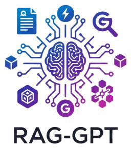

<div align="center">



# RAG-GPT · Chat with your PDFs

**LangChain · ChromaDB · Streamlit · Gemini / GPT-4o / Claude**

> Upload PDFs, ask questions, get grounded answers with page citations — streamed in real time.

</div>

---

## What it does

You drop one or more PDFs into the sidebar. The app chunks, embeds, and indexes them locally. Then you chat. Every answer cites the exact file and page it came from. If the answer isn't in your documents, the model says so — it doesn't guess.

- 🔍 Answers grounded strictly in your documents
- 📄 Page-level citations on every response
- 🚀 Token streaming — no waiting for the full answer
- 🧠 Remembers the last 3 turns for follow-up questions
- 🏠 Embeddings run 100% locally — one API key total
- ⚡ Windows users: just double-click `start.bat`

---

## Quick start

**Windows shortcut:** double-click `start.bat` — it handles everything below automatically.

```bash
# 1. Clone
git clone https://github.com/abhijitprakashborade/rag_techtaru_digital.git
cd rag_techtaru_digital

# 2. Virtual environment
python -m venv .venv
.venv\Scripts\activate          # Windows
# source .venv/bin/activate     # macOS / Linux

# 3. Install
pip install -r requirements.txt

# 4. Configure
copy .env.example .env          # then open .env and add your key
```

Minimum `.env` (free Gemini tier):

```ini
LLM_PROVIDER=gemini
GOOGLE_API_KEY=your-key-here   # free key → aistudio.google.com/apikey
```

```bash
# 5. Run
streamlit run app.py
# Opens at http://localhost:8501
```

> **Try it instantly:** click **"⚡ Load sample PDF"** in the app and ask *"What is the learning budget?"* — no PDF needed.

---

## Environment variables

| Variable | Required | Notes |
|---|---|---|
| `LLM_PROVIDER` | ✅ | `gemini` · `openai` · `anthropic` |
| `GOOGLE_API_KEY` | if gemini | [aistudio.google.com/apikey](https://aistudio.google.com/apikey) (free) |
| `OPENAI_API_KEY` | if openai | [platform.openai.com/api-keys](https://platform.openai.com/api-keys) |
| `ANTHROPIC_API_KEY` | if anthropic | [console.anthropic.com](https://console.anthropic.com/) |
| `LLM_MODEL` | No | Override model; defaults auto-select per provider |
| `LANGCHAIN_TRACING_V2` | No | `true` enables LangSmith tracing |
| `LANGCHAIN_API_KEY` | No | LangSmith key (only if tracing on) |

---

## Project structure

```
rag_techtaru_digital/
├── app.py                     # Streamlit UI — upload, chat, session state
├── rag/
│   ├── config.py              # constants, prompts, provider resolution
│   ├── document_processor.py  # PDF extraction, chunking, SHA-256 dedup
│   ├── vector_store.py        # ChromaDB CRUD, local embeddings, MMR
│   ├── chain.py               # LCEL chain, streaming, retry
│   └── utils.py               # citations, export, formatting
├── assets/                    # logo
├── sample_docs/               # bundled demo PDF
├── tests/                     # unit tests (no LLM calls)
├── .env.example               # environment template
├── start.bat                  # Windows one-click launcher
└── requirements.txt
```

---

## How it works

**Upload:** pdfplumber extracts text page-by-page (pypdf fallback for edge cases) → `RecursiveCharacterTextSplitter` (800 chars / 150 overlap) → `all-MiniLM-L6-v2` embeds locally → written to persistent ChromaDB. SHA-256 dedup skips re-embedding identical files.

**Chat:** the last 3 turns rewrite ambiguous follow-ups into standalone queries → MMR retrieval (`k=4` from 20 candidates, λ=0.7) → strict QA prompt streamed token-by-token → citations pulled from the same stream.

---

## Deploy (Streamlit Community Cloud — free)

1. Fork the repo on GitHub.
2. [share.streamlit.io](https://share.streamlit.io) → **New app** → pick the repo, entry point `app.py`.
3. App settings → **Secrets**:

```toml
LLM_PROVIDER = "gemini"
GOOGLE_API_KEY = "your-free-key"
```

No `.env` file needed — the app reads `st.secrets` automatically.

---

## Tests

```bash
pytest tests/ -v
```

Covers hashing, chunking, citation formatting, XSS escaping, config invariants, and chat-history windowing. None of them call an LLM.

---

## Reset the vector store

```bash
rmdir /s /q chroma_db    # Windows
rm -rf chroma_db         # macOS / Linux
```

Documents are re-indexed on next upload.

---

## License

[MIT](LICENSE) · Built with ❤️ by **Abhijit Borade** · [Techtaru Digital](https://techtaru.com)
